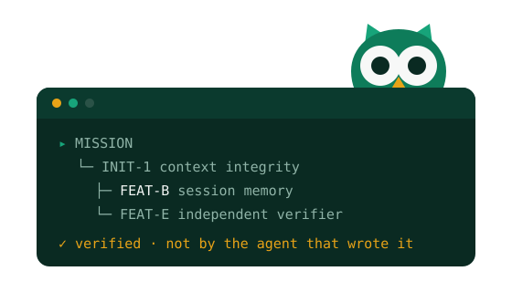

<div align="center">



# Get Started with Archon OS

### From install to your first TDD workflow in under 10 minutes

</div>

---

> **Already installed?** Skip to [Your first workflow](#your-first-workflow).
> **Brand new?** Start with [Prerequisites](#prerequisites).
> **Want a guided tour?** [FIRST_WORKFLOW_TUTORIAL.md](FIRST_WORKFLOW_TUTORIAL.md) is hands-on (15 min).

**What is Archon OS?** [Claude Code](https://docs.anthropic.com/en/docs/claude-code) is Anthropic's agentic coding tool. Archon OS turns it into a planning-first LLM OS: 15 agents, 5-phase TDD workflows, hierarchical planning (T0–T4) that survives session resets, forensic reasoning traces, semantic conflict detection, and per-agent MCP security. Full breakdown: [README § The 8 Pillars](../../README.md#-the-8-pillars-of-the-planning-first-llm-os).

---

## Prerequisites

1. **Claude Code installed.** Follow [Anthropic's installation guide](https://docs.anthropic.com/en/docs/claude-code) if you haven't.
2. **A terminal with Claude Code running.** Just type `claude` in any project directory.
3. **Git working tree** for the project you want to use Archon OS on (Archon OS works against any local repo).

---

## Install Archon OS

In the Claude Code chat, run two commands:

```bash
/plugin marketplace add nguyenthienthanh/archon
/plugin install archon-os@archon
```

That's it. Archon OS is now installed globally and available in every Claude Code session.

**Verify** the install:

```
/help
```

You should see a category called *Archon OS* listing commands like `/run`, `/af`, `/archon-os:plan`, `/check`, `/project`.

**Initialize for this project (optional, recommended once):**

```
/project init
```

Detects your tech stack, configures integrations (JIRA / Confluence / Slack), and seeds a project-specific config. Skip and Archon OS will use sensible defaults.

> **Need supplementary install paths?** CLI symlink, manual install, or environment-variable setup → see [INSTALLATION.md](../operations/INSTALLATION.md).

---

## Your first workflow

Archon OS uses **one entry point**: `/run`. Type it with a task description and Archon OS auto-detects intent (bugfix / feature / refactor / test / review / deploy / security / quality) and picks the right flow.

### Tiny task — direct edit

```
/run fix typo in README
```

Archon OS classifies this as **Quick** complexity, makes the edit inline, and reports back. No phases, no gates.

### Feature task — full 5-phase TDD

```
/run add a login endpoint with email + password
```

Archon OS classifies this as **Deep** complexity and runs the 5-phase workflow:

```
Phase 1: Understand + Design   → [APPROVAL GATE]
Phase 2: Test RED              → Auto-continue
Phase 3: Build GREEN           → [APPROVAL GATE]
Phase 4: Refactor + Review     → Auto-continue
Phase 5: Finalize              → Auto-complete
```

**Only 2 approval gates** (Phase 1 & 3) — other phases auto-continue after showing deliverables. At a gate, type a bare verb (no slash prefix needed when a run is active):

| Verb | What it does |
|---|---|
| `approve` | advance to the next phase |
| `reject <reason>` | redo this phase with the feedback |
| `modify <changes>` | adjust deliverables without restarting the phase |
| `handoff` | save state for the next session |
| `status` / `progress` / `rollback` / `stop` | introspect or unwind |

Bugfix runs use a lighter 4-step flow (`S1` investigate → `S2` test RED → `S3` fix GREEN → `S4` verify). Quick / Standard runs skip phases entirely.

### Project-scale task — bootstrap a plan tree

```
/run project: ship the billing redesign across web + mobile + admin
```

Archon OS escalates to **hierarchical planning** (`/archon-os:plan`): bootstraps `MISSION → INIT → FEAT → STORY → TASK` under `.claude/plans/`, then resumes execution against the active task. See [HIERARCHICAL_PLANNING.md](../architecture/HIERARCHICAL_PLANNING.md).

---

## What's next

Pick one based on what you want to learn:

| To learn… | Read… |
|---|---|
| The full command surface | [QUICKSTART.md](QUICKSTART.md) — 5 min reference card |
| How a real run unfolds end-to-end | [WALKTHROUGH.md](WALKTHROUGH.md) — JWT-auth transcript |
| The hands-on tutorial | [FIRST_WORKFLOW_TUTORIAL.md](FIRST_WORKFLOW_TUTORIAL.md) |
| Runtime mechanics + plan tree | [HIERARCHICAL_PLANNING.md](../architecture/HIERARCHICAL_PLANNING.md) |
| The OS mental model (Karpathy) | [os-architecture.md](../architecture/os-architecture.md) |
| Which agent will pick up your task | [AGENT_SELECTION_GUIDE.md](../guides/AGENT_SELECTION_GUIDE.md) |
| Bundled MCPs + how to add your own | [MCP_GUIDE.md](../operations/MCP_GUIDE.md) |
| How learning + feedback works (no setup) | [LEARNING_SYSTEM.md](../operations/LEARNING_SYSTEM.md) |
| Token cost per workflow flavour | [TOKEN_BUDGET.md](TOKEN_BUDGET.md) |
| 8 Pillars deep dive | [BENEFITS.md](../reference/BENEFITS.md) |

---

## Troubleshooting

Top 5 install-time questions — fuller fixes in [TROUBLESHOOTING.md](../operations/TROUBLESHOOTING.md).

1. **`/plugin marketplace add` reports an error.** Make sure your Claude Code is recent enough to support marketplace plugins (Anthropic ships this in current builds). If not, use the [manual install path](../operations/INSTALLATION.md#manual-install).
2. **`/help` doesn't show Archon OS commands.** Re-run `/plugin install archon-os@archon`; check that `~/.claude/plugins/marketplaces/archon/archon-os/` exists.
3. **First `/run` doesn't auto-detect a flow.** Type a more concrete verb-noun task description (e.g. `/run add password reset to the login form`). Force flow with prefixes: `/run task: …` / `/run project: …`. Disable escalation per-session with `AF_ESCALATION_DISABLED=true`.
4. **An approval gate seems stuck.** Type bare `status` to see what's pending, or bare `rollback` to revert to the last checkpoint. Full action list above.
5. **MCP server didn't fire.** Some MCPs need env vars (`FIGMA_API_TOKEN`, `SLACK_BOT_TOKEN`, `firebase login`). They silently no-op if unset — see [MCP_GUIDE.md](../operations/MCP_GUIDE.md) for per-MCP setup.

---

**You're ready.** Type `/run <your task>` and Archon OS takes it from there.
