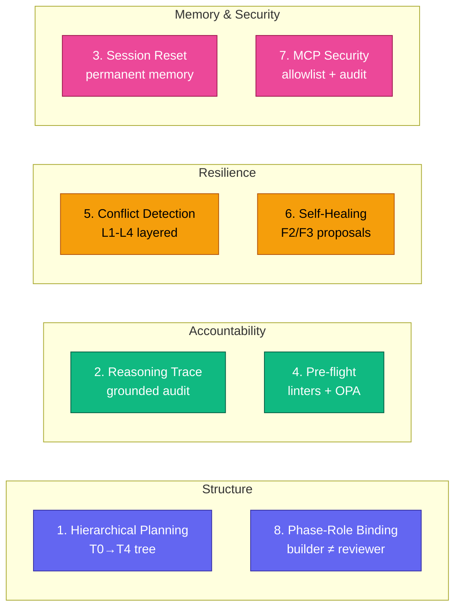

# The 8 Pillars

Archon OS is eight features that compose into one system. Each one exists because of a
specific way shipping with an AI agent goes wrong, and each one can be switched off with a
single environment variable — so you can adopt them one at a time.

This page is the reference. For the short version, see the
[README](../../README.md#what-it-gives-you); for the engineering depth behind each pillar,
see [BENEFITS.md Part 9](BENEFITS.md#part-9--the-8-pillars-of-the-planning-first-llm-os-v370).

---

v3.7.0 introduced **eight features** that compose into one cohesive OS; v3.7.2 + v3.7.3 polished their entry points + storage layout (notably Pillar 1). Each pillar solves a real failure mode of shipping with an AI agent. Status legend: ✅ shipped · 🚧 queued for v3.8+.

| # | Pillar | One-liner | Status |
|---|---|---|---|
| 1 | **Hierarchical Planning** | Plans survive session reset · `/compact` · machine restart. v3.7.3: uniform folder-per-node layout under `.claude/plans/` · run↔feature linking | ✅ |
| 2 | **Reasoning Trace Audit** | Every Claude decision is forensically recorded with grounded evidence | ✅ |
| 3 | **Semantic Session Reset** | Finished an Epic? Distill it into permanent memory, then reset cleanly | ✅ |
| 4 | **Pre-flight Validation** | Bash linters block bad AI output before it hits disk | ✅ Tier 1 · 🚧 Tier 2 OPA |
| 5 | **Semantic Conflict Detection** | L1-L4 layered detection prevents silent overwrites between parallel tasks | ✅ L1+L2 · 🚧 L3+L4 LLM |
| 6 | **Self-Healing Orchestrator** | Auto-diagnose F2/F3 failures, propose patches — never auto-apply | ✅ manual · 🚧 auto-trigger |
| 7 | **MCP Security Layer** | Per-agent allowlist, audit log, rate limits — defense for external integrations | ✅ |
| 8 | **Phase-Role Binding** | Phase 4 reviewer MUST differ from Phase 3 builder (Generator ≠ Evaluator) | ✅ |

---

### 1 · Hierarchical Planning  ✅

A plan tree (Mission → Initiative → Feature → Story → Task) that persists to `.claude/plans/` and survives session resets, `/compact`, and machine restarts. v3.7.3 ships uniform `{ID}_{kebab-slug}/` folder-per-node layout, run↔feature bidirectional linking (`run-state.json` ↔ feature's `## Runs` table), and the consolidated `/archon-os:plan <verb>` surface (`expand` · `next` · `replan` · `promote` · `archive` · `undo` · `freeze` · `thaw` · `conflicts` · `status`). Bare-word activation when a plan is active: type `next`, `expand FEAT-A`. The `/run` escalation heuristic (v3.7.2) prompts plan-mode for multi-feature tasks (weight ≥ 3) — overrides: `task:` / `project:` prefixes, `ARCHON_ESCALATION_DISABLED=true`. Full depth + DAG examples in [BENEFITS.md Part 9 §1](BENEFITS.md#part-9--the-8-pillars-of-the-planning-first-llm-os-v370) and [HIERARCHICAL_PLANNING.md](../architecture/HIERARCHICAL_PLANNING.md).

### 2 · Reasoning Trace Audit  ✅

Every Claude decision during T4 execution is forensically recorded to a per-task `trace.jsonl` (co-located with the task spec). Captured events: file reads, output claims, tool calls, decisions — each linked to the grounding evidence. The trace is the source of truth for grounding-discipline checks (anti-hallucination); deliverables that cite a file must show a corresponding read event. Query via `/trace` (planned CLI shipped in helper scripts). Disable per-session with `ARCHON_TRACE_DISABLED=true`. Full schema + worked examples in [BENEFITS.md Part 9 §2](BENEFITS.md#part-9--the-8-pillars-of-the-planning-first-llm-os-v370).

### 3 · Semantic Session Reset  ✅

Long projects accumulate decisions that don't fit in a context window. When a Feature ships, `epic-summarizer` distils its history into `.claude/memory/permanent_memory.md` — a confidence-scored, append-only memo (low-confidence items land in a Tentative subsection). Future sessions load only the header lines via `permanent-memory-loader` (≤120 always-loaded tokens, hard cap 200). `/reset-session` triggers the distil + optional clean-slate restart. Lets you take a Mission across weeks without context creep. Full depth in [BENEFITS.md Part 9 §3](BENEFITS.md#part-9--the-8-pillars-of-the-planning-first-llm-os-v370).

### 4 · Pre-flight Validation  ✅ Tier 1 · 🚧 Tier 2

Bash linters that block bad AI output before it hits disk. Tier 1 ships seven checks (path safety, command allowlist, secret patterns, frontmatter shape, markdown sanity, slash-syntax currency, doc maturity). Tier 2 (queued for v3.8) adds OPA + five `.rego` policies for declarative org-specific gates. Hook-driven — fires on Write/Edit. Bypass with 3-warn confirmation when the linter is wrong. Disable with `ARCHON_PREFLIGHT_DISABLED=true`. Full rules in [BENEFITS.md Part 9 §4](BENEFITS.md#part-9--the-8-pillars-of-the-planning-first-llm-os-v370).

### 5 · Semantic Conflict Detection  ✅ L1+L2 · 🚧 L3+L4

Parallel `/run` tasks can step on each other. v3.7 ships L1 (file-overlap) and L2 (function/region overlap) deterministic checks, plus a freeze-cascade state machine that pauses descendants when a parent conflicts. L3 (semantic, LLM-judged) and L4 (architectural, LLM-judged) ship in v3.7.0-rc.1+. `conflict-arbiter` adjudicates — outcomes recorded to `conflicts.jsonl` + history. Disable LLM tiers with `ARCHON_CONFLICT_LLM_DISABLED=true`. Full state machine + sample conflicts in [BENEFITS.md Part 9 §5](BENEFITS.md#part-9--the-8-pillars-of-the-planning-first-llm-os-v370).

### 6 · Self-Healing Orchestrator  ✅ manual · 🚧 auto-trigger

When `failure-classifier` flags a task as F2 (local-logic) or F3 (local-design), the self-healing skill proposes a patch — but **never auto-applies**. Confidence ≥0.7 is required to surface; below threshold the raw findings are escalated to the user. Auto-trigger on the F2/F3 classification hook is queued for v3.7.2+. Per-task cap: 1 self-heal attempt; per-session cap: 5. Disable with `ARCHON_SELF_HEAL_DISABLED=true`. Full workflow in [BENEFITS.md Part 9 §6](BENEFITS.md#part-9--the-8-pillars-of-the-planning-first-llm-os-v370).

### 7 · MCP Security Layer  ✅

Per-agent allowlist for MCP calls + audit log + rate limits + input sanitization. The `mcp-call-gate` hook authorises every MCP invocation against the agent's declared scope; blocked + rate-limited calls land in `.aura/security/mcp-audit.jsonl`. Post-incident forensics via `/archon-os:mcp audit`. Tokens never leave the process. Disable audit-only with `ARCHON_MCP_AUDIT_DISABLED=true`. Full threat model in [BENEFITS.md Part 9 §7](BENEFITS.md#part-9--the-8-pillars-of-the-planning-first-llm-os-v370) and [SECURITY_AND_TRUST.md](../operations/SECURITY_AND_TRUST.md).

### 8 · Phase-Role Binding  ✅

The Phase 4 reviewer **MUST** differ from the Phase 3 builder. Generator ≠ Evaluator is enforced by `run-orchestrator` and `cross-review-workflow.md` — self-reviewed code has blind spots that PR reviews catch in human teams; same logic for agents. Non-negotiable. The constraint is what makes the 5-phase workflow produce shippable code, not just code that passes its own tests. Full rationale in [BENEFITS.md Part 9 §8](BENEFITS.md#part-9--the-8-pillars-of-the-planning-first-llm-os-v370).

### Status snapshot — what ships now vs queued

| Pillar | Ships now (v3.7.0 + v3.7.2/v3.7.3 polish) | Queued for v3.8+ |
|---|---|---|
| 1 — Planning | T0-T4 tree at `.claude/plans/`, **uniform folder-per-node layout** (v3.7.3), **consolidated `/archon-os:plan <verb>`** (v3.7.2), 12 backing scripts, 5 agents, bare-word router, `link-run.sh` for run↔feature bidirectional linking | — |
| 2 — Reasoning Trace | tracer hook (writes per-task `trace.jsonl` inside the task folder, v3.7.3), grounding-discipline, `/trace` queries | helper CLI scripts (deferred per [issue #6](https://github.com/nguyenthienthanh/archon/issues/6)) |
| 3 — Session Reset | epic-summarizer, permanent-memory-loader (`.claude/memory/`), `/reset-session` | — |
| 4 — Pre-flight | 7 Tier-1 bash linters, hook, bypass with 3-warn | Tier 2 OPA + 5 `.rego` policies |
| 5 — Conflict Detection | L1 (file) + L2 (function) + freeze cascade + arbitration | L3 (semantic LLM) + L4 (architectural LLM) |
| 6 — Self-Healing | manual `/heal diagnose`, ≥0.7 confidence, never auto-apply | auto-trigger hook on F2/F3 classification |
| 7 — MCP Security | per-agent allowlist + audit + rate limits + sanitizer | SQLite WAL for audit ([issue #8](https://github.com/nguyenthienthanh/archon/issues/8)) |
| 8 — Phase-Role | hard rule in `cross-review-workflow.md` + run-orchestrator | — |
| Routing — `/run` | **3-option escalation** (`plan`/`deep`/`details`) on weight ≥ 3, **`task:` / `project:` override prefixes** (v3.7.2), **`feature: <ID>` prefix** + **`resume <FEATURE_ID>`** (v3.7.3) | — |

Disable any pillar individually via env var: `ARCHON_SELF_HEAL_DISABLED`, `ARCHON_MCP_AUDIT_DISABLED`, `ARCHON_TRACE_DISABLED`, `ARCHON_PREFLIGHT_DISABLED`, `ARCHON_CONFLICT_LLM_DISABLED`, `ARCHON_RUN_PLAN_BRIDGE_DISABLED`, `ARCHON_TOKEN_TRACKER_DISABLED`, `ARCHON_BARE_WORD_ROUTER_DISABLED`, `ARCHON_ESCALATION_DISABLED`. Override the plans dir entirely with `ARCHON_PLANS_DIR=<path>` (e.g. to keep using legacy `.aura/plans/`). All eight pillars + the v3.7.2/v3.7.3 routing additions are opt-in friendly.
