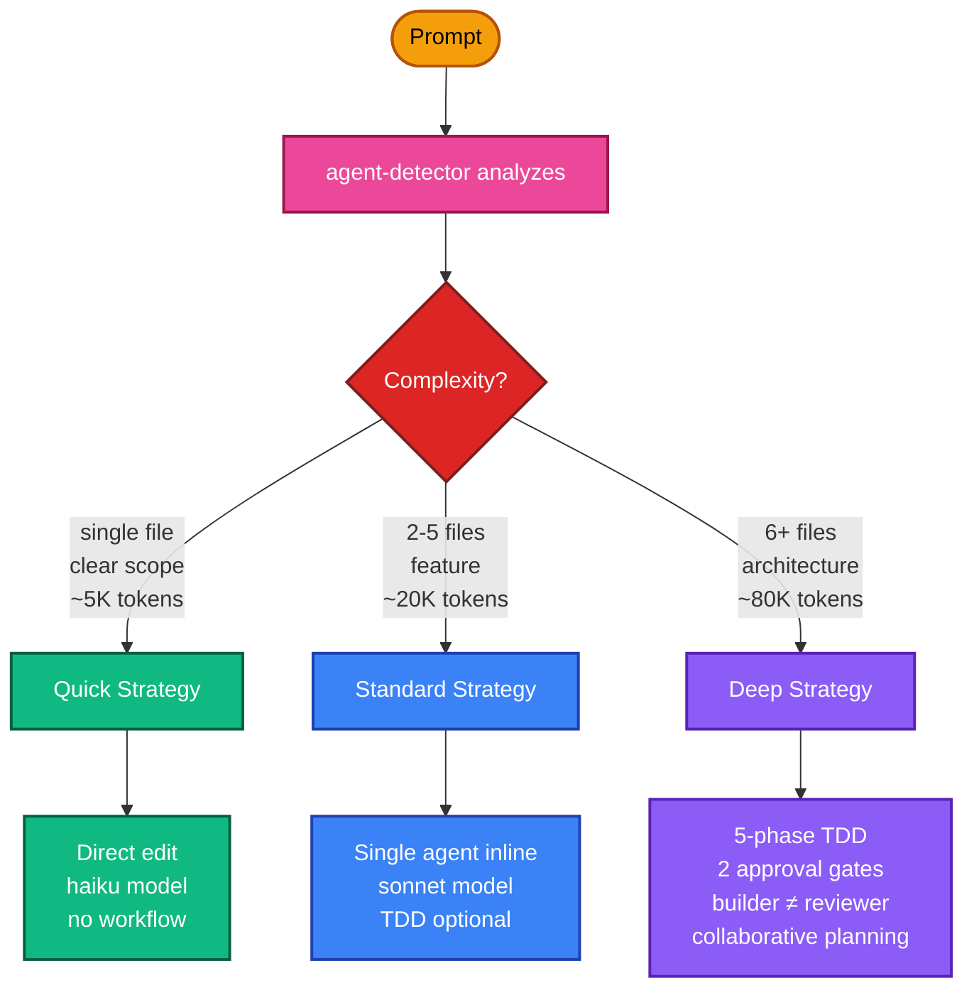
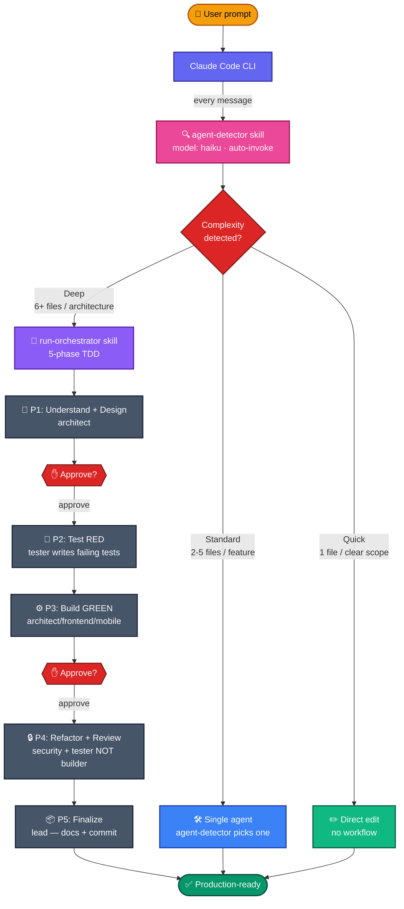

# Routing: how Archon OS decides how hard to work

You never pick a strategy. You describe the task; `agent-detector` reads it and routes.
This page explains what it is deciding, so the decision is predictable rather than magic.

---

## The three strategies

Archon OS picks one of three execution strategies per task — you never configure it manually.

| Strategy | Triggers | Model | Gates | Example |
|---|---|---|---|---|
| **Quick** | Single file, typo, one-line fix | haiku | 0 | "Fix typo in login.ts" |
| **Standard** | 2–5 files, one feature | sonnet | 0–1 | "Add email validation to signup form" |
| **Deep** | 6+ files, architecture, vague scope | sonnet (opus for design) | 2 (P1 + P3) | "Design and implement user subscription system" |

**Why three tiers instead of always-TDD?** Forcing Deep on every task burns tokens (~3× vs subagent mode) and slows iteration. Forcing Quick on complex work skips tests and breaks production. The three-tier model matches effort to risk.

**Team Mode** (subset of Deep): if the task spans 2+ domains AND `CLAUDE_CODE_EXPERIMENTAL_AGENT_TEAMS=1`, multiple agents work in parallel and cross-review each other. See [AGENT_TEAMS_GUIDE](../guides/AGENT_TEAMS_GUIDE.md).

Details: `rules/core/execution-rules.md`, `skills/agent-detector/SKILL.md`, `skills/run-orchestrator/SKILL.md`.

---

## How a prompt becomes shipped code

**The flow, explained:**
1. **Every message** you send goes through the `agent-detector` skill (runs on haiku for cost) — it classifies complexity + picks the right agent + suggests the right model.
2. **Quick tasks** (typo, one-line fix) → direct edit, no workflow overhead.
3. **Standard tasks** (one feature, clear scope) → single specialized agent runs inline.
4. **Deep tasks** (feature + multi-file + TDD) → `run-orchestrator` spawns the 5-phase workflow with two human approval gates.
5. Between phases, you either **approve**, **reject**, or **modify** — no commit happens until Phase 5 and you say so.
